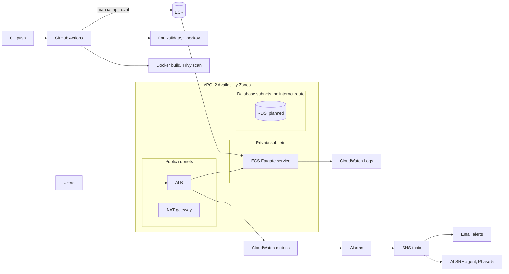
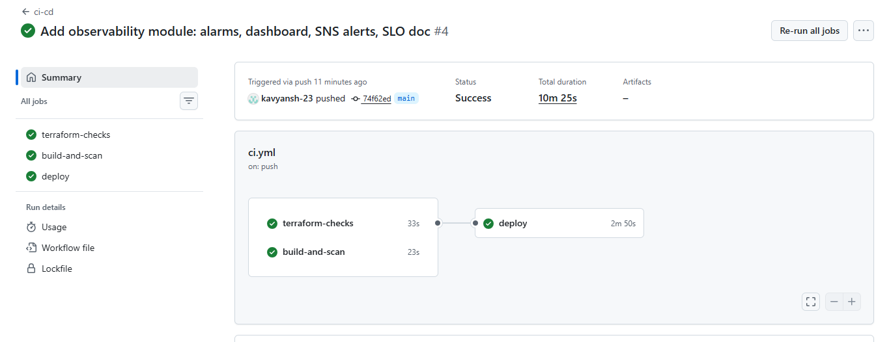
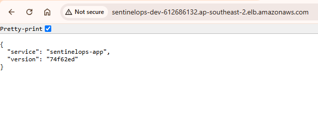
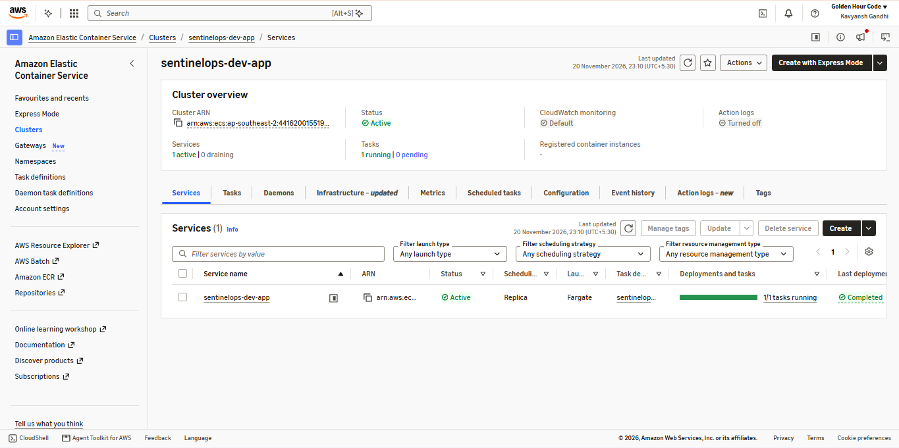
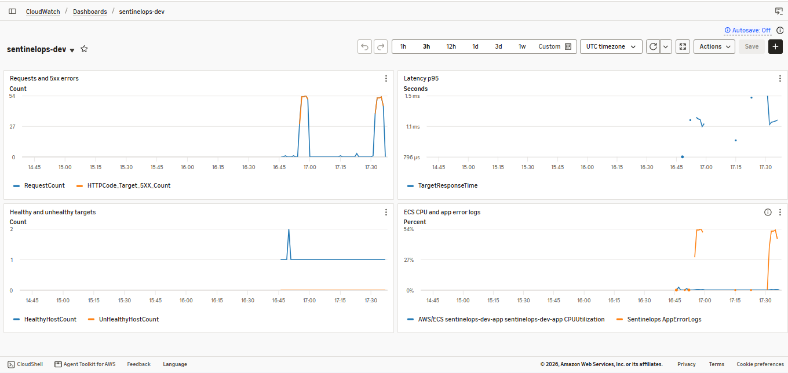
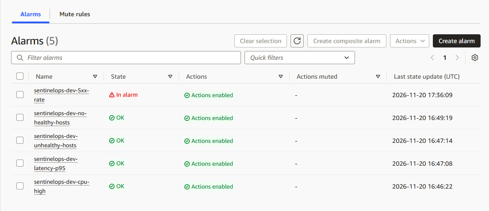
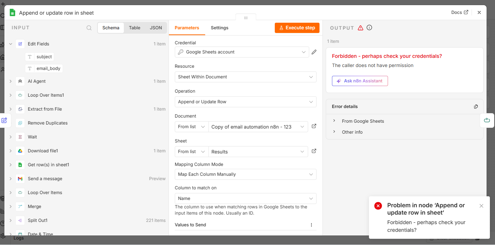
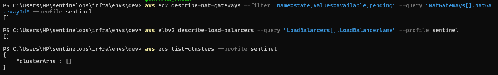

# SentinelOps

A containerised service on AWS, built entirely as code, with CI/CD, observability and SLOs. An AI on-call agent that investigates alarms is the next phase and is in progress.

**Stack:** Terraform, Amazon ECS Fargate, Application Load Balancer, ECR, CloudWatch, SNS, GitHub Actions, Docker, Checkov, Trivy.

## Project status

| Phase | Scope | Status |
|---|---|---|
| 1 | Terraform remote state (S3), 3-tier multi-AZ VPC module | Done |
| 2 | Flask app, ECR, ALB and ECS Fargate modules | Done |
| 3 | CI/CD: IaC checks, image scan, approval-gated deploy with smoke test | Done |
| 4 | Alarms, dashboard, SNS alerts, SLOs | Done |
| 5 | AI SRE agent (tool-calling loop, audit log, guarded actions) | In progress |
| 6 | Chaos scripts and MTTR measurements | Planned |

## Architecture



## What is built

**Infrastructure (Terraform)**
- Remote state in S3 with versioning, encryption, public access blocked and native state locking.
- VPC module: public, private and isolated database subnets across two AZs, one NAT gateway for the dev environment, and free S3 and DynamoDB gateway endpoints.
- ALB module: security group, listener, target group with health checks.
- ECS service module: Fargate task, task and execution roles, log group, security group that only accepts traffic from the ALB, and a deployment circuit breaker with automatic rollback.
- Observability module: SNS topic, a log metric filter, five CloudWatch alarms and a dashboard.
- Everything is tagged through provider-level default tags.

**CI/CD (GitHub Actions)**
- On every push and pull request: `terraform fmt -check`, `terraform validate`, Checkov IaC scan, Docker build and Trivy image scan.
- On `main`: a deploy job that waits for manual approval in a protected GitHub environment, pushes the image to ECR, registers a new ECS task definition, waits for the service to stabilise and smoke-tests the live URL against the new version.
- If the environment is not running, the deploy job pushes the image and skips the ECS steps.

**Application**
- Small Flask service with structured JSON logs and endpoints for deliberate failures (`/error`, `/slow`, `/cpu`) used for alarm and chaos testing.

## Evidence

### CI/CD pipeline


Terraform checks, image build and scan, then the approval-gated deploy job.

### The deployed version matches the pipeline commit


The service reports version `74f62ed`, the commit SHA of the pipeline run above.

### ECS service on Fargate


One of one task running, last deployment completed.

### Dashboard under load


Request count and 5xx spikes, p95 latency, healthy and unhealthy targets, CPU and the count of application error logs.

### Alarm fires


The 5xx-rate alarm moves to ALARM after sustained errors from the `/error` endpoint.

### Alert delivered


SNS delivers the alarm email: two of the last two datapoints were above the 5% threshold.

### Teardown verified


After each working session the environment is destroyed and checked: no NAT gateways, load balancers or ECS clusters remain.

## Service level objectives

| SLI | Definition | SLO (30 days) | Error budget |
|---|---|---|---|
| Availability | Share of requests that do not return a 5xx | 99.5% | 0.5% of requests |
| Latency | Share of requests served in under 1 second (p95) | 95% | 5% of requests may be slower |

Alarms: 5xx rate above 5% for 2 minutes (evaluated only above 10 requests per minute), p95 latency above 1 second, unhealthy targets, no healthy targets, and ECS CPU above 80%. Full details are in [`docs/slo.md`](docs/slo.md).

## Engineering notes

This runs in a managed AWS project account whose organization policy limits what can be created. Those limits shaped some decisions:

- **Region:** only Sydney (`ap-southeast-2`) is allowed, so the whole project is built there.
- **GitHub authentication:** creating an IAM OIDC provider is denied by the account's policy. Deployments therefore use a least-privilege IAM user (one ECR repository and one ECS service) whose keys live in an approval-gated GitHub environment. OIDC federation is the preferred approach and is the first thing I would switch to in an account that allows it.
- **Chaos testing:** AWS Fault Injection Service is blocked, so failures are injected with my own scripts (killing tasks, load, a bad deployment).
- **AI model:** Amazon Bedrock model quotas on this account are zero, so the agent will call an external model API, with the key kept in AWS Secrets Manager. The model is a configuration value.
- **Scanners:** Checkov and Trivy currently run in report-only mode. The plan is to fix the findings and then make both block the pipeline.
- **Deployments:** ECS rolling updates with a circuit breaker. Blue/green is a future option.

## Cost control

The NAT gateway and load balancer bill hourly, so the dev environment is applied for a working session and then destroyed. The state bucket and ECR repository persist. A budget alert is set on the account.

## Repository layout

```
.
├── app/                    Flask app and Dockerfile
├── docs/                   SLOs and screenshots
├── infra/
│   ├── bootstrap/          State bucket, ECR repository and deploy user
│   ├── envs/dev/           Dev environment
│   └── modules/
│       ├── vpc/
│       ├── alb/
│       ├── ecs-service/
│       └── observability/
└── .github/workflows/      CI/CD pipeline
```

## Deploying

```bash
# one-time: state bucket and ECR (edit the bucket name in envs/dev/backend.tf to match your account)
cd infra/bootstrap
terraform init && terraform apply

# environment
cd ../envs/dev
export TF_VAR_alert_email="you@example.com"
terraform init && terraform apply

# when finished
terraform destroy
```

## Roadmap

- [ ] AI SRE agent: tool-calling loop (logs, metrics, deployments, summary), strict tool allow-list, DynamoDB audit log
- [ ] Guarded actions (rollback, scale) with human approval through Step Functions
- [ ] Chaos scripts and measured time to detect and resolve, with and without the agent
- [ ] RDS PostgreSQL in the isolated database subnets
- [ ] Enforce Checkov and Trivy findings as pipeline gates
- [ ] Architecture diagram image and a short demo video
